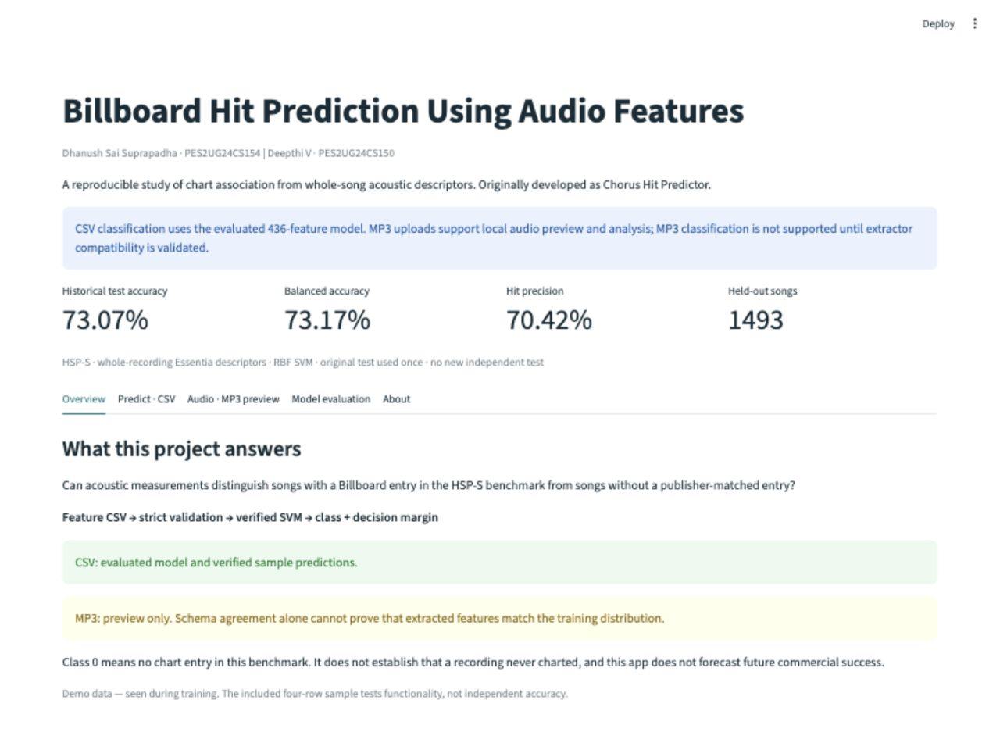
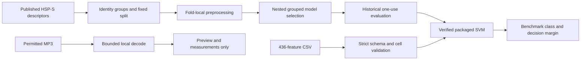
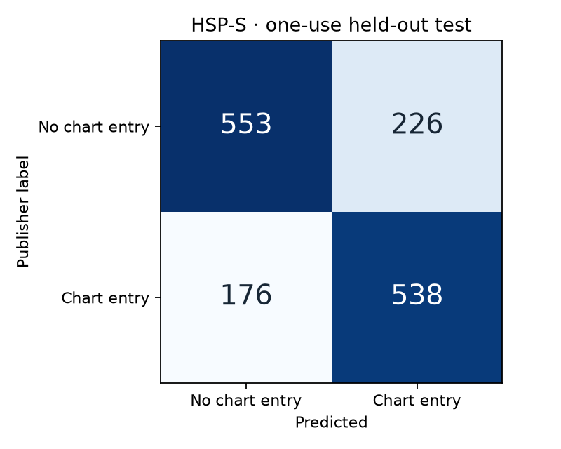
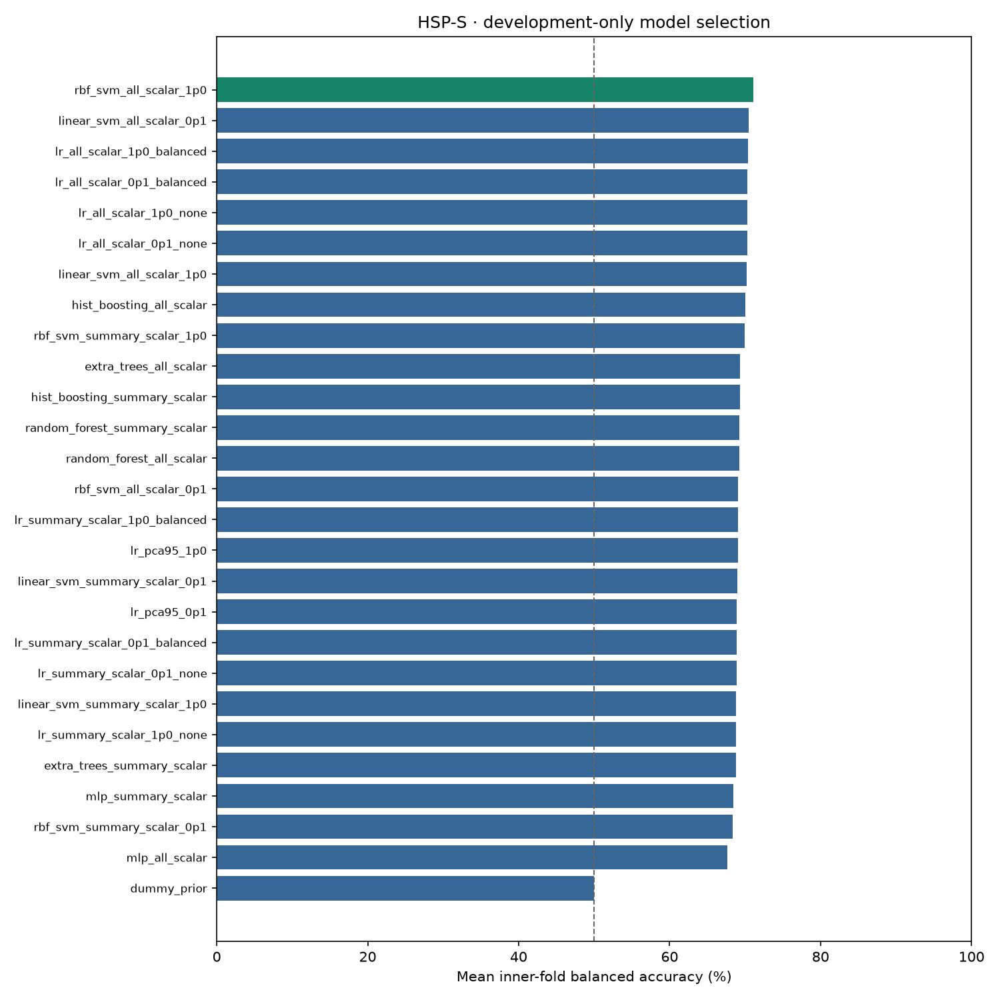

# Billboard Hit Prediction Using Audio Features

**A reproducible academic study of Billboard chart association from whole-song sound.**

[](https://github.com/DhanushSS/chorus-hit-predictor/actions/workflows/tests.yml)

[](https://zenodo.org/records/5383858)

Can acoustic measurements help distinguish recordings with a Billboard entry
from those without a publisher-matched entry? This project explores that question
using **436 whole-recording Essentia features**, artist-connected validation, and
a verified RBF SVM. Its historical name is *Chorus Hit Predictor*; the current
model does **not** use 15-second chorus features or forecast future success.

| Historical test accuracy | Balanced accuracy | Accepted songs | Audio features |
| :---: | :---: | :---: | :---: |
| **73.07%** | **73.17%** | **7,728** | **436** |

[Get started](#quick-start) · [Results](#results) · [New research](docs/research_v2/model_improvement_report.md) · [Audit status](docs/audit/issue_resolution_matrix.md) · [Team](#team)



*Captured from the running application. No public hosted service is claimed.*

## What you can do

| Mode | Current capability | Important boundary |
| --- | --- | --- |
| **Feature CSV** | Validate, classify, inspect margins and download predictions | Exact 436-feature schema; 1–100 rows; 5 MiB |
| **MP3 upload** | Local playback, waveform envelope and audio measurements | Preview only; 25 MiB, ≤480 seconds; **no classification** |
| **Model evaluation** | View real confusion matrix, model comparison and saved results | Historical test was consumed once; new work is development-only |

The isolated modern Essentia probe supplies **381/436** expected fields. No
same-master audio/reference pairs are available, so schema and numeric parity
are unproven. The app intentionally returns **no hit score for MP3s**. See the
[compatibility study](docs/audio_upload/feature_compatibility.md) and
[upload contract](docs/audio_upload/upload_contract.md).

## Workflow



## Results

| Metric | Original nested development | Historical held-out test |
| --- | ---: | ---: |
| Accuracy | 70.97% | **73.07%** |
| Balanced accuracy | 70.94% | **73.17%** |
| Chart-entry precision | 70.18% | 70.42% |
| Chart-entry recall | 74.01% | 75.35% |
| Chart-entry F1 | 72.04% | 72.80% |
| Macro F1 | 70.93% | 73.07% |
| ROC-AUC | Not recorded | 0.8076 |

Test: **1,493 songs / 527 connected groups**. Balanced-accuracy 95% group-bootstrap
interval: **70.20–76.08%**, conditional on this dataset and fixed model.
The 79.60% training score is in-sample and is **not** an 80% accuracy achievement.

| Historical confusion matrix | Original development comparison |
| --- | --- |
|  |  |

The model falsely marked **226** no-entry records as chart entries and missed
**176** chart-entry records. These are real errors, not removed examples.
[Historical results](docs/hit_nonhit/hsp_s_results/README.md) retain the original evidence.

### New development-only research

The predeclared 11-configuration study completed **226 fits**, with no failures
or warnings. Nested development accuracy reached **71.69%**, balanced accuracy
**71.65%** (95% group interval **69.91–73.59%**), compared with original nested
development BA **70.94%**. Hard voting was selected in final development CV.
**80% was not reached.** Its
[complete results and uncertainty](docs/research_v2/model_improvement_report.md)
are exploratory development estimates. The original test and deployed model
remain unchanged. **A new untouched external test is NOT AVAILABLE.**

## Dataset and method

- **HSP-S:** 7,736 publisher records; 7,728 retained after eight duplicate/conflict exclusions.
- **Classes:** 3,865 chart entries; 3,863 records with no publisher-matched entry.
- **Development:** 6,235 songs / 2,106 connected groups; five outer and three inner folds.
- Known artist, recording, album, work-proxy and duplicate links stay together.
- Only scalar low-level, rhythm and tonal descriptors enter the model; chart
  outcomes, listening counts and artist metadata are excluded from predictors.
- Imputation, variance filtering, scaling and selection fit within training folds.
- Packaged model: RBF SVM, `C=1.0`, `gamma=scale`, balanced class weights.
- Original selection compared 27 fixed configurations before the one-use test.

**Class 0 means “No chart entry in HSP-S benchmark.”** It is not independently
verified lifetime non-hit status. Source/codec bias remains measurable: the
historical nuisance-only classifier reached 61.08% balanced accuracy. Unknown
aliases, recording versions and genre/era gaps remain limitations. Results from
different datasets or label definitions cannot establish that this project beats
Eric Liu's study. [Protocol](docs/hit_nonhit/hsp_s_protocol.md) ·
[Group and confound audit](docs/research_v2/group_leakage_audit.md).

## Quick start

Use **Python 3.12** and the pinned model environment. No GPU or API token is needed.

```bash
git clone --branch feat/mp3-csv-ui-readme-research-v2 https://github.com/DhanushSS/chorus-hit-predictor.git
cd chorus-hit-predictor
python3.12 -m venv .venv
source .venv/bin/activate
python -m pip install -r requirements-dev.txt
python scripts/setup_model.py
python -m streamlit run app.py
```

Open `http://localhost:8501`. In **Predict · CSV**, upload
[`data/example_features.csv`](data/example_features.csv), then choose
**Validate and classify CSV**. Download the template for matching descriptors.
The four sample rows were **seen during training**: they demonstrate functionality,
not independent accuracy. Positive/negative SVM margins correspond to chart-entry /
no-entry classes; margin magnitude is **not probability**.

[Actual CSV result screenshot](docs/assets/app_csv.jpg) ·
[Actual generated-MP3 preview screenshot](docs/assets/app_mp3_preview.jpg)

In **Audio · MP3 preview**, confirm permission, upload an MP3 and choose **Analyze
MP3**. The screenshot uses a software-generated tone, not a commercially released
song or an accuracy test. Raw uploads are temporary and are not sent to APIs.

Setup verifies the bundled model checksum, file manifest, implementation and
package versions; it does not retrain. Install dependencies online once, then
run inference offline. **macOS/Linux** are the verified targets. Native Windows
training/MP3 supervision is unsupported; Windows CSV serving is not verified.
Essentia is optional and isolated: [installation and profile](docs/audio_upload/feature_compatibility.md).

## Reproducibility and tests

```bash
python -m pip check
python scripts/setup_model.py
python -m pytest -q
```

The suite exercises model integrity, saved predictions, connected groups,
fold-local processing, CSV validation, genuine generated-MP3 decoding, timeouts,
cleanup, feature mapping, fail-closed audio inference and both Streamlit modes.
CI runs the core suite on macOS/Linux and a separate Linux Essentia schema probe.
See [delivery evidence](docs/audit/final_delivery_report.md) for exact counts and SHAs.

Research reproduction commands and data/code hashes are in the
[new research report](docs/research_v2/model_improvement_report.md).
Do not reopen the original holdout or remove its access ledger.
[Current operations](docs/current_operations.md) supersedes the historical
handoff's old page paths. [Model bundle](models/README.md) documents installation.

## Technology and layout

Python · Streamlit · pandas/NumPy · scikit-learn · SoundFile · matplotlib.
Essentia supplies the published source descriptors and the optional isolated probe.

| Path | Purpose |
| --- | --- |
| `app.py` | Overview, CSV prediction, MP3 preview, evaluation and attribution |
| `chorus_hit/hsp_s/` | Frozen original model implementation |
| `chorus_hit/ui_components/` | Current CSV validation |
| `chorus_hit/audio_upload/` | Bounded decoding and unvalidated extractor research |
| `chorus_hit/research_v2/` | Development-only registered comparisons |
| `models/` | Preserved trained model and checksum receipt |
| `configs/`, `tests/`, `scripts/` | Reproducibility, regression tests and tools |
| `docs/` | Real screenshots, results, protocol and issue resolution |

## Team

| Name | SRN |
| --- | --- |
| **Dhanush Sai Suprapadha** | **PES2UG24CS154** |
| **Deepthi V** | **PES2UG24CS150** |

## Attribution and origins

HSP-S: **Michael Vötter, Maximilian Mayerl, Günther Specht and Eva Zangerle (2021)**,
*Novel Datasets for Evaluating Song Popularity Prediction Tasks*,
[DOI 10.5281/zenodo.5383858](https://zenodo.org/records/5383858), **CC BY 4.0**.
Labels reflect publisher Billboard matching through 6 July 2019. Our changes
include scalar selection, duplicate/conflict exclusions, identity grouping,
model fitting and evaluation. See [NOTICE](NOTICE) and [sample attribution](data/README.md).

The original repeated-chorus study, inspired by Eric Liu's hit-song research,
older datasets, models and completed results remain in the
[public historical archive](https://github.com/DhanushSS/chorus-hit-predictor-archive-2026-10-11).
The archived 278-song candidate project obtained zero permitted exact recordings;
this whole-song benchmark does not resolve that acquisition blocker.
[Archive/migration receipt](docs/repository_migration.md).

No raw commercial recordings, credentials or private filesystem paths are distributed.
