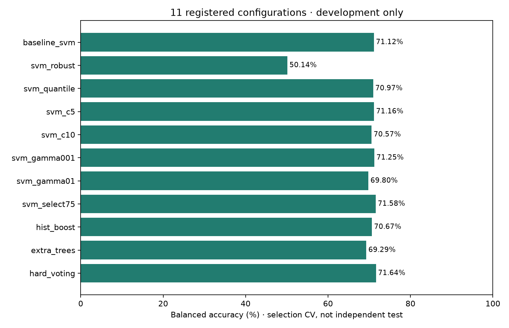

# Development-only model improvement report

## Decision

**80% not reached. New untouched external test: NOT AVAILABLE.**
The existing packaged SVM and historical 73.07% accuracy / 73.17% balanced accuracy
are preserved. No new model is deployed or given an independent-test claim.

## Data and design

HSP-S, Vötter et al. (2021), [CC BY 4.0 source](https://zenodo.org/records/5383858):
7,736 original records; eight documented duplicate/conflict exclusions; 7,728
accepted (3,865 chart-entry / 3,863 publisher no-entry). Only the frozen **6,235
song / 2,106 connected-group development set**, class counts
`{'0': 3084, '1': 3151}`, enters new fits. All 436 inputs are whole-recording
scalar audio descriptors; no chart, popularity or artist metadata predictors.
Negative labels do not establish lifetime non-hit status. No new audio acquired.

Config [research_v2.json](../../configs/research_v2.json) was committed before
execution (`4d028c9`). Seed 20261008; 5 outer / 3 inner group folds; 11 candidates;
90 seconds per fit; 7,200 seconds accumulated fit budget. All imputation,
variance filtering, scaling and supervised feature selection fit inside each
training fold. Candidate selection uses inner mean balanced accuracy, not outer
scores. Diagnostic controls were fixed in advance; no seed or label changes.

## Nested development results

| Metric | Fixed C=1 baseline, same folds | Nested candidate-selection procedure |
| --- | --- | --- |
| Accuracy | 71.64% | 71.69% |
| Balanced Accuracy | 71.60% | 71.65% |
| Precision | 70.53% | 70.65% |
| Recall | 75.40% | 75.25% |
| F1 | 72.88% | 72.88% |
| Macro F1 | 71.58% | 71.64% |

BA 95% connected-group percentile bootstrap intervals (1,000 draws):
fixed baseline **69.84%–73.62%**; nested procedure
**69.91%–73.59%**. Intervals are conditional on this cohort and
OOF predictions; they do not capture repeated study-design selection uncertainty.
The original 27-candidate nested development BA was **70.94%**; its estimate is
not identical to evaluating a single fixed baseline. These comparisons do not
prove a statistically reliable improvement or independent generalization.

Nested OOF confusion matrix, rows true [no-entry, entry], columns predicted same:
`[[2099, 985], [780, 2371]]`. Every development record receives one outer-fold prediction.



## All registered configurations

| Configuration | Final development 3-fold selection BA |
| --- | --- |
| baseline_svm | 71.12% |
| svm_robust | 50.14% |
| svm_quantile | 70.97% |
| svm_c5 | 71.16% |
| svm_c10 | 70.57% |
| svm_gamma001 | 71.25% |
| svm_gamma01 | 69.80% |
| svm_select75 | 71.58% |
| hist_boost | 70.67% |
| extra_trees | 69.29% |
| hard_voting | 71.64% |

These final-selection CV values rank candidates; they are **not nested estimates
for each candidate** or external scores. Outer-fold selections:
`['hard_voting', 'hard_voting', 'svm_c5', 'hard_voting', 'hard_voting']`.
Final selection: `{"family": "voting", "id": "hard_voting", "scaler": "standard"}`.
SVMs use balanced classes, max_iter=20000 and cache_size=256. HistGradientBoosting:
200 iterations, 15 leaves, learning_rate=.08, L2=5, no internal random early-stop
split. ExtraTrees: 300 trees, min_samples_leaf=3, balanced, one thread.
Hard voting: SVM + HistGradientBoosting + balanced LogisticRegression C=.1,
max_iter=3000; no in-sample stacking or fabricated probabilities.

The bounded grid covers robust/quantile scaling, ANOVA 75% feature selection,
C/gamma changes and stronger learner families. Threshold tuning, probabilities,
external boosting libraries, additional family-subset/PCA grids and stacking
were not added after inspecting scores. This is a finite study, not a claim of
exhaustive optimization or maximum attainable accuracy.

## Warnings, attempts and reproducibility

Completed run: **226 trials; 0 failed; 0 warned; 0 skipped**.
Recorded accumulated trial wall time: **571.3 seconds**;
bootstrap/report time is additional. Full trial outcomes, timings, warning text,
outer selections, intervals and config/data/code hashes are in [results.json](results.json).
Warnings count by category: `{}`.
No warning was removed, no failed candidate silently accepted. [Run log](run_log.md)
records the interrupted preliminary run and logging correction; its completed
trial records are preserved in [aborted_run_001.json](aborted_run_001.json).
The final implementation was committed as `fdc0e1f` before run 002.

```bash
python -m chorus_hit.research_v2.run --split output/hsp_s/split_001 --out output/research_v2/reproduction_001
python scripts/summarize_research_v2.py --split output/hsp_s/split_001 --run output/research_v2/reproduction_001 --out output/research_v2/reproduction_report
```

Use a **new destination** and the immutable split prepared by the original
[HSP-S protocol](../hit_nonhit/hsp_s_protocol.md). A new clone can download the
pinned source and run `prepare` into a fresh split location with the original
config; do not run the test evaluator. The development loader verifies file
hashes and cross-partition identity groups but only deserializes development
features/labels. Hashing the old locked file for integrity is not a new test
measurement. The access ledger, dataset, bundle and historical results are unchanged.

## Bias, sensitivity and explainability

See [group_leakage_audit.md](group_leakage_audit.md) for all diagnostics.
Codec/source confounding remains unresolved. The historical nuisance-only BA of
61.08% and within-group permutations around 66% remain valid cautions; neither
was erased. Global-null controls answer a different question and do not certify
absence of artist or collection bias. No future-popularity or MP3-accuracy claim
follows from these descriptor-only development results.
